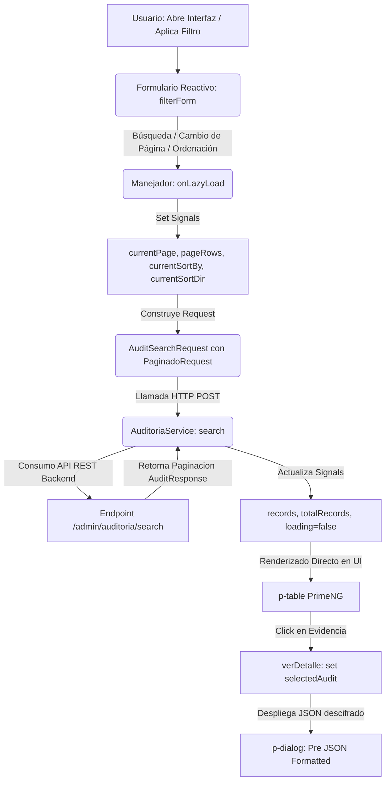

# Especificación Técnica: Interfaz de Auditoría Segura y Evidencia Forense (Frontend)

Esta especificación técnica detalla la arquitectura reactiva, el flujo de datos del cliente, los contratos de TypeScript y el diseño estructural de componentes del subsistema de visualización de auditoría segura.

---

## 1. Arquitectura de Datos y Flujo Reactivo

La interfaz de usuario utiliza un patrón reactivo impulsado por **Angular Signals** y **PrimeNG 21** para interactuar asíncronamente con la API de auditoría forense del backend.



---

## 2. Contratos de TypeScript (Modelos e Interfaces Core)

Todas las estructuras de datos están fuertemente tipadas en el frontend para evitar el uso de `any` y asegurar coherencia con los contratos DTO del backend.

### A. Catálogos y Enums (`auditoria.model.ts`)
```typescript
// Módulos genéricos editables. Mapea aquí los módulos reales de tu backend
export enum AuditModule {
  SEGURIDAD = 'SEGURIDAD',
  USUARIOS = 'USUARIOS',
  SISTEMA = 'SISTEMA'
}

// Acciones genéricas editables. Mapea aquí las acciones que audita tu backend
export enum AuditAction {
  LOGIN_EXITOSO = 'LOGIN_EXITOSO',
  LOGIN_FALLIDO = 'LOGIN_FALLIDO',
  REGISTRO_CREADO = 'REGISTRO_CREADO',
  REGISTRO_MODIFICADO = 'REGISTRO_MODIFICADO'
}
```

### B. Estructura de Petición y Paginación (`paginacion.model.ts` & `auditoria.model.ts`)
```typescript
export interface PaginadoRequest {
  page: number;      // 0-indexed para la paginación del backend (ej: Spring Pageable)
  rows: number;      // Tamaño de página (límite de registros)
  sortBy: string;    // Campo de ordenamiento (ej: 'fecha')
  sortDir: number;   // Dirección del orden (0 = ASC, 1 = DESC)
}

export interface AuditSearchRequest {
  fechaInicio: string | null; // ISO 8601 OffsetDateTime
  fechaFin: string | null;    // ISO 8601 OffsetDateTime
  accion: AuditAction | null;
  modulo: AuditModule | null;
  folio: string | null;       // Identificador único de negocio
  paginado: PaginadoRequest;
}
```

### C. Estructura de Respuesta de Auditoría
```typescript
export interface PaginadoResponse {
  totalRecords: number;
  pageCount: number;
  page: number;
  rows: number;
  sortBy: string;
  sortDir: number;
}

export interface AuditResponse {
  id: string;              // UUID único del evento de auditoría
  fecha: string;           // ISO DateTime del registro
  username: string;        // Identidad del usuario que realizó la acción
  perfil: string;          // Rol o perfil del usuario
  accion: AuditAction;     // Acción realizada
  modulo: AuditModule;     // Módulo afectado
  canal: string;           // Canal de origen (WEB | MOBILE | BATCH)
  ipAddress: string;       // Dirección IP cliente
  folio: string | null;    // Identificador de negocio relacionado (folio, id)
  metadata: Record<string, unknown>; // Payload forense (CBOR/JSON original)
}

export interface Paginacion<T> {
  list: T[];
  paginado: PaginadoResponse;
}
```

---

## 3. Especificación de Componentes UI (PrimeNG 21 & Tailwind)

La interfaz se compone de cuatro secciones estructurales clave:

### A. Cabecera Forense Premium (`p-toolbar`)
*   **Acento de Marca**: Contiene el isotipo o ícono institucional (`pi-shield`) envuelto en un contenedor circular con los estilos visuales de tu organización.
*   **Sello de Integridad**: Distintivo visual responsivo a la derecha que certifica la validez matemática del Hash Chain SHA-256 en el backend y archivos forenses.

### B. Panel de Filtros Fluidos Reactivos (`p-fluid` + Reactive Forms)
*   **Rango de Fechas**: Controlado por dos `p-datepicker` con bloqueo reactivo de fecha mínima (`[minDate]="fechaInicio"`).
*   **Selectores con Autocompletado**: Uso de `p-select` para Módulo y Acción, este último con soporte de filtro interactivo (`[filter]="true"`).
*   **Búsqueda por Texto**: Caja de búsqueda de Folio/ID de negocio encapsulada en `p-iconfield` para una apariencia moderna.

### C. Tabla de Evidencia Forense (`p-table` con Carga Diferida)
*   **Lazy Loading**: Configurado con `[lazy]="true"`, vinculando la paginación nativa al backend.
*   **Propiedades dinámicas**:
    *   `[totalRecords]="totalRecords()"`: Controla el cálculo de páginas.
    *   `[rows]="pageRows()"`: Controla la cantidad de renglones mostrados.
    *   `[loading]="loading()"`: Controla la visualización del spinner de carga.
*   **Ordenamiento por Columnas**: Cabeceras con la directiva `pSortableColumn="campo"` acopladas al backend.
*   **Visualización Detallada**: Botón de ojo (`pi-eye`) con tooltip flotante para abrir la ventana modal de metadatos.

### D. Modal de Evidencia CBOR/JSON (`p-dialog`)
*   **Aislamiento y Enfoque**: Diálogo modal bloqueante (`[modal]="true"`) que despliega el UUID de transacción, la fecha con microsegundos y la dirección IP.
*   **Formateador JSON Estructurado**: Renderizador del mapa `metadata` mediante el pipe de Angular (`| json`) incrustado en un bloque de código `<pre>` estilizado con colores oscuros de terminal (`bg-surface-950 text-emerald-400 font-mono`) para legibilidad impecable.

---

## 4. Estado de Signals y Reactividad Declarativa

El componente gestiona su ciclo de vida y estado visual de manera declarativa con los siguientes Signals y RxJS interoperativos:

1.  **Catálogos Reactivos (`toSignal`)**:
    *   `modulos()`: Array reactivo de `AuditModule[]`.
    *   `acciones()`: Array reactivo de `AuditAction[]`.
2.  **Estado del Listado**:
    *   `records()`: Array actual de `AuditResponse[]`.
    *   `totalRecords()`: Número total de elementos disponibles en la base de datos.
    *   `loading()`: Flag booleano del estado de petición HTTP.
    *   `pageRows()`: Límite de registros por página.
3.  **Estado de Paginación Interno**:
    *   `currentPage()`: Página actual (0-indexed).
    *   `currentSortBy()`: Columna por la cual ordenar.
    *   `currentSortDir()`: Dirección de ordenamiento (0/1).
4.  **Estado de Diálogo**:
    *   `showDetailDialog()`: Control de visibilidad del modal.
    *   `selectedAudit()`: Registro de auditoría seleccionado para desplegar la evidencia CBOR/JSON.
