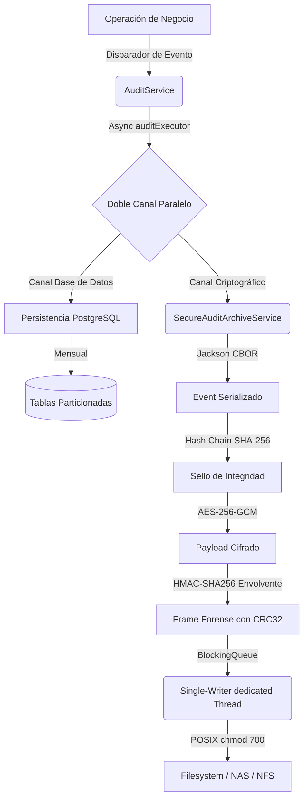

# Especificación Técnica: Subsistema de Auditoría Segura y Evidencia Forense

Esta especificación técnica detalla la arquitectura, el flujo de datos, el diseño criptográfico y el formato de almacenamiento físico estructurado del subsistema de auditoría segura.

---

## 1. Arquitectura de Datos y Flujo de Resiliencia

El subsistema utiliza un patrón de persistencia paralela asíncrona aislado por hilos virtuales de Java 21 para desacoplar el procesamiento transaccional del negocio del guardado de logs:



---

## 2. Formato del Frame Binario Forense (Bloque de Evidencia)

Cada registro de auditoría se guarda consecutivamente en disco como una cadena binaria estructurada de tamaño variable de acuerdo a las siguientes especificaciones estructurales de offset:

```
+------------------+--------------+-------------+--------------------+----------------+-------------------+-------------------+-------------------+--------------------+-------------------+-----------------+
| Magic Bytes (4B) | Version (1B) | Suite (1B)  | Frame Length (4B)  | Timestamp (8B) | IV Length (1B)    | IV Bytes (var)    | Hash Anterior(32) | Hash Actual(32)   | Encrypted Payload  | HMAC Signature  |
| (0xCAFE0A0D)     | (0x01)       | (0x01 = AES)| (Longitud total)   | (Epoch MS UTC) | (Typically 12B)   | (SHA-256)         | (SHA-256)         | (AES-256-GCM)      | (Cubre todo!)     |
+------------------+--------------+-------------+--------------------+----------------+-------------------+-------------------+-------------------+--------------------+-------------------+-----------------+
```

### Campos del Frame:
1.  **Magic Bytes (4 Bytes)**: `0xCAFE0A0D`. Identificador constante para control de posición e integridad rápida.
2.  **Version (1 Byte)**: Versión de estructura de log (`0x01`).
3.  **Cipher Suite (1 Byte)**: Algoritmo de encriptación (`0x01` para `AES-256-GCM` y `HMAC-SHA256`).
4.  **FrameLength (4 Bytes - Integer)**: Longitud total en bytes de todo el bloque (excluyendo el CRC32 final) para control de saltos en streaming.
5.  **Timestamp (8 Bytes - Long)**: Marca de tiempo Epoch en milisegundos UTC.
6.  **IV Length (1 Byte)**: Tamaño del vector de inicialización (típicamente 12 bytes para GCM).
7.  **IV Bytes (Variable)**: Vector de inicialización único para esta encriptación.
8.  **Hash Anterior (32 Bytes)**: Hash SHA-256 del bloque inmediatamente precedente en la cadena criptográfica diaria.
9.  **Hash Actual (32 Bytes)**: Hash SHA-256 calculado sobre este log concatenado:
    $$\text{hashActual} = \text{SHA-256}(\text{hashAnterior} + \text{payloadCifrado} + \text{timestamp})$$
10. **Encrypted Payload (Variable)**: Datos del evento (modulo, accion, usuario, ip, metadatos estructurados en CBOR) cifrados en AES-256-GCM.
11. **HMAC Signature (32 Bytes)**: Firma simétrica HMAC-SHA256 calculada sobre **todo** el bloque precedente (Campos 1 al 10).
12. **CRC32 Checksum (4 Bytes)**: CRC32 de hardware/físico para verificar que el bloque no se haya escrito o leído de forma trunca de disco.

---

## 3. Modelo Matemático del Hash Chain

La inalterabilidad de la secuencia se basa en la imposibilidad matemática de modificar un bloque antiguo sin recalcular todos los hashes siguientes del día:

```
[Bloque N-1]                 [Bloque N]                  [Bloque N+1]
+---------------+            +---------------+           +---------------+
| HashActual:   | ---------> | HashAnterior: |           | HashAnterior: |
| 0xAB8F32C...  |            | 0xAB8F32C...  |           | 0xCD89EF0...  |
+---------------+            +---------------+           +---------------+
                             | HashActual:   | --------> | HashActual:   |
                             | 0xCD89EF0...  |           | 0x1234567...  |
                             +---------------+           +---------------+
```

Si el servidor se detiene de forma abrupta (apagón de energía), el primer bloque vacío al final del archivo es detectado mediante su firma HMAC fallida. El algoritmo de auto-recuperación trunca el archivo físicamente hasta la última posición válida detectada por `HMAC + CRC32`, obteniendo el `HashActual` de ese bloque como semilla inicial para la siguiente transacción.

---

## 4. Contratos de Clases e Interfaces Core

### `AuditStorageProvider`
Desacopla la lógica criptográfica de almacenamiento del filesystem.
```java
public interface AuditStorageProvider {
    Path getActiveLogPath(String fileName);
    Path getFallbackLogPath(String fileName);
    Path createDirectoryStructure() throws IOException;
    boolean acquireLock(String lockName) throws IOException;
    void releaseLock(String lockName);
}
```

### `AuditCryptoService`
Centraliza la criptografía.
```java
public interface AuditCryptoService {
    byte[] encrypt(byte[] plaintext, byte[] iv) throws Exception;
    byte[] decrypt(byte[] ciphertext, byte[] iv) throws Exception;
    byte[] calculateHMAC(byte[] data) throws Exception;
    boolean verifyHMAC(byte[] data, byte[] signature) throws Exception;
    byte[] generateIV();
}
```

### `AuditHashChainService`
Administra el encadenamiento criptográfico.
```java
public interface AuditHashChainService {
    byte[] calculateNextHash(byte[] previousHash, byte[] encryptedPayload, long timestamp);
    byte[] initializeOrRecoverChain(Path activeFile);
}
```

### `AuditFileWriter`
Cola interna acotada y procesador de un único hilo para escrituras.
```java
public class AuditFileWriter {
    private final LinkedBlockingQueue<byte[]> queue;
    private final ExecutorService singleWriterExecutor;
    private final AuditStorageProvider storageProvider;
    
    public void enqueue(byte[] binaryFrame);
    public void rotateLogs();
    public void shutdownAndFlush();
}
```

---

## 5. Especificación de Eventos del Módulo de Citas y Seguridad 2FA (Negocio)

El Módulo de Citas y el subsistema de validación 2FA interactúan directamente con el `AuditService` asíncrono para generar marcas forenses de negocio. Cada evento almacena metadatos obligatorios en formato JSONB para garantizar la inmutabilidad y el no repudio.

### Catálogo de Acciones Auditables y Metadata Asociada

#### A. Flujo de Agendamiento
*   **Acciones**: `CITA_AGENDADA_CIUDADANO` | `CITA_AGENDADA_AGENTE`
*   **Módulo**: `CITAS`
*   **Metadata JSON**:
    ```json
    {
      "servicioId": "UUID",
      "sedeId": "UUID",
      "fechaCita": "yyyy-MM-dd'T'HH:mm:ss",
      "correoCiudadano": "String (Normalizado / Mayúsculas)",
      "canalAgendamiento": "String (CIUDADANO | AGENTE)",
      "agenteCreadorId": "String (UUID | N/A)"
    }
    ```

#### B. Flujo de Cancelación y Reagendamiento
*   **Acciones**: `CITA_CANCELADA_CIUDADANO` | `CITA_CANCELADA_ADMIN` | `CITA_REAGENDADA`
*   **Módulo**: `CITAS`
*   **Metadata JSON (Cancelación)**:
    ```json
    {
      "motivo": "String",
      "canalSolicitud": "String (CIUDADANO | AGENTE)",
      "correoCiudadano": "String",
      "servicioId": "UUID",
      "sedeId": "UUID",
      "agenteCanceladorId": "String (UUID | N/A)"
    }
    ```
*   **Metadata JSON (Reagendamiento)**:
    ```json
    {
      "fechaAnterior": "yyyy-MM-dd'T'HH:mm:ss",
      "fechaNueva": "yyyy-MM-dd'T'HH:mm:ss",
      "canalSolicitud": "String",
      "correoCiudadano": "String",
      "servicioId": "UUID",
      "sedeId": "UUID"
    }
    ```

#### C. Flujo de Atención en Ventanilla (Métricas de Desviación y Conclusión)
*   **Acciones**: `CITA_ATENCION_INICIADA` | `CITA_ATENCION_FINALIZADA`
*   **Módulo**: `CITAS`
*   **Metadata JSON (Inicio de Atención)**:
    ```json
    {
      "sedeId": "UUID",
      "servicioId": "UUID",
      "fechaCita": "yyyy-MM-dd'T'HH:mm:ss (Programada)",
      "fechaRealAtencionInicio": "yyyy-MM-dd'T'HH:mm:ss (Real)",
      "desviacionInicioSegundos": "Long (Diferencia de tiempo)"
    }
    ```
*   **Metadata JSON (Finalización de Atención)**:
    ```json
    {
      "duracionMinutos": "Long",
      "sedeId": "UUID",
      "servicioId": "UUID",
      "fechaRealAtencionFin": "yyyy-MM-dd'T'HH:mm:ss"
    }
    ```

#### D. Auditoría de Lecturas (Read Audit / Protección de Privacidad PII)
*   **Acción**: `CITA_BUSQUEDA_CONSULTADA`
*   **Módulo**: `CITAS`
*   **Metadata JSON**:
    ```json
    {
      "tipoBusqueda": "String (FOLIO | CORREO | HASH_QR | DESCONOCIDO)",
      "criterioBusqueda": "String (Query de búsqueda)",
      "resultadosEncontrados": "Integer"
    }
    ```

#### E. Seguridad 2FA (Brute Force Detection)
*   **Acciones**: `FALLO_VALIDACION_TOKEN_2FA` | `BLOQUEO_TOKEN_2FA_INTENTOS_EXCEDIDOS`
*   **Módulo**: `SEGURIDAD`
*   **Lógica de Acoplamiento Estricto**:
    El sistema requiere obligatoriamente `correo`, `sedeId` y `servicioId` para validar e incrementar intentos de forma segmentada, evitando colisiones entre múltiples citas concurrentes del mismo ciudadano en diferentes sedes. El token se bloquea (`validado = true`) al tercer intento erróneo de forma permanente.
*   **Metadata JSON**:
    ```json
    {
      "correoCiudadano": "String",
      "tipoToken": "String (flujo del token)",
      "sedeId": "UUID (Normalizado a String)",
      "servicioId": "UUID (Normalizado a String)",
      "intentosAcumulados": "Integer"
    }
    ```

#### F. Acciones Batch y Cancelaciones Masivas
*   **Acciones**: `CANCELACION_DIA_ACTUAL_EJECUTADA` | `CANCELACION_MASIVA_EJECUTADA` | `CANCELACION_AUTOMATICA_POR_VENCIMIENTO` | `FALLO_EJECUCION_CANCELACION_MASIVA`
*   **Módulo**: `CITAS`
*   **Metadata JSON**:
    ```json
    {
      "citasAfectadas": "Integer (Conteo de registros)",
      "motivo": "String",
      "rangoFechas": "String (Si aplica)",
      "fechaCita": "String (Si aplica)"
    }
    ```

#### G. Seguridad Perimetral y Control de Acceso
*   **Acciones**: `ACCESO_TOKEN_INVALIDO` | `ACCESO_DENEGADO_PRIVILEGIOS` | `VIOLACION_POLITICA_CORS`
*   **Módulo**: `SEGURIDAD`
*   **Metadata JSON (Token Inválido)**:
    ```json
    {
      "uri": "String (Request URI)",
      "metodoHttp": "String (GET|POST|etc)",
      "detalleError": "String (Mensaje de excepción)",
      "tipoErrorToken": "String (TOKEN_EXPIRADO | FIRMA_INVALIDA | TOKEN_AUSENTE | TOKEN_INVALIDO)"
    }
    ```
*   **Metadata JSON (Acceso Denegado / Privilegios Insuficientes)**:
    ```json
    {
      "uri": "String",
      "metodoHttp": "String",
      "usuarioId": "UUID (Normalizado a String)",
      "rolesUsuario": "String (Roles separados por coma)",
      "rolesRequeridos": "String (Rol mínimo requerido)",
      "descripcion": "String (Mensaje de denegación)"
    }
    ```
*   **Metadata JSON (Violación de CORS)**:
    ```json
    {
      "uri": "String",
      "metodoHttp": "String",
      "origenNoAutorizado": "String (Host origen bloqueado)",
      "origenPermitidos": "String (Orígenes permitidos configurados)",
      "descripcion": "String (Mensaje de infracción)"
    }
    ```

#### H. Canal de Sincronización JIT
*   **Acciones**: `AUTENTICACION_JIT_EXITOSA` | `FALLO_SINCRONIZACION_JIT` | `FALLO_DESCARGA_LLAVES_JWKS`
*   **Módulo**: `SEGURIDAD`
*   **Metadata JSON (JIT Exitosa)**:
    ```json
    {
      "usuarioId": "UUID (Normalizado a String)",
      "rolesUsuario": "String (Roles sincronizados)",
      "tipoSincronizacion": "String (CREACION | ACTUALIZACION)"
    }
    ```
*   **Metadata JSON (Fallo JWKS - Caídas de Identity Provider)**:
    ```json
    {
      "jwkSetUri": "String (URI de descarga de llaves públicas)",
      "detalleError": "String",
      "descripcion": "String"
    }
    ```

#### I. Módulo de Sedes y Días Laborables
*   **Acciones**: `SEDE_CREADA` | `SEDE_ACTUALIZADA` | `SEDE_ELIMINADA` | `SERVICIO_VINCULADO_A_SEDE` | `SERVICIO_DESVINCULADO_DE_SEDE` | `DIA_LABORABLE_SEDE_CREADO` | `DIA_LABORABLE_SEDE_ELIMINADO`
*   **Módulo**: `SEDES`
*   **Metadata JSON (Sede Creada / Eliminada)**:
    ```json
    {
      "nombre": "String",
      "municipio": "String",
      "direccionCompleta": "String",
      "ventanillas": "Integer",
      "toleranciaMinutos": "Integer",
      "boactivo": "Boolean (Solo creación)"
    }
    ```
*   **Metadata JSON (Sede Actualizada - Delta de Cambios)**:
    ```json
    {
      "nombre": "String",
      "cambios": {
        "KEY_CAMPO": {
          "antes": "Object (Valor anterior)",
          "despues": "Object (Valor nuevo)"
        }
      }
    }
    ```
*   **Metadata JSON (Días Laborables de Sede)**:
    ```json
    {
      "sedeId": "UUID (Normalizado a String)",
      "diaSemana": "String (Nombre del día)"
    }
    ```

#### J. Módulo de Servicios y Requisitos
*   **Acciones**: `SERVICIO_CREADO` | `SERVICIO_ACTUALIZADO` | `SERVICIO_ELIMINADO` | `REQUISITO_SERVICIO_AGREGADO` | `REQUISITO_SERVICIO_ACTUALIZADO` | `REQUISITO_SERVICIO_ELIMINADO`
*   **Módulo**: `SERVICIOS`
*   **Metadata JSON (Servicio Creado / Eliminado)**:
    ```json
    {
      "nombre": "String",
      "descripcion": "String",
      "maxDiasAnticipacion": "Integer",
      "minHorasCancelacion": "Integer",
      "boactivo": "Boolean"
    }
    ```
*   **Metadata JSON (Servicio Actualizado - Deltas)**:
    ```json
    {
      "nombre": "String",
      "cambios": "Map (Diferencias antes/despues)"
    }
    ```
*   **Metadata JSON (Requisitos de Servicio)**:
    ```json
    {
      "requisitoId": "UUID (Normalizado a String)",
      "descripcion": "String (O deltas de cambios en actualización)"
    }
    ```

#### K. Módulo de Configuración y Vigencias
*   **Acciones**: `VIGENCIA_CREADA` | `VIGENCIA_ACTUALIZADA` | `VIGENCIA_ELIMINADA` | `INTERVALO_CREADO` | `INTERVALO_ACTUALIZADO` | `INTERVALO_ELIMINADO` | `DIA_INHABIL_GLOBAL_CREADO` | `DIA_INHABIL_GLOBAL_ELIMINADO` | `DIA_INHABIL_SEDE_CREADO` | `DIA_INHABIL_SEDE_ELIMINADO`
*   **Módulo**: `CONFIGURACION`
*   **Lógica de Negocio (Deltas e Integridad)**:
    Las actualizaciones de vigencias e intervalos generan deltas de cambios de cada campo modificado (`KEY_CAMBIOS`), almacenados de forma inmutable en el log para auditoría forense rápida de alteraciones en las reglas de disponibilidad del sistema.

#### L. Módulo de Sistema e Infraestructura
*   **Acción**: `FALLO_NOTIFICACION_CORREO`
*   **Módulo**: `SISTEMA`
*   **Metadata JSON**:
    ```json
    {
      "destinatario": "String (Email destino)",
      "asunto": "String (O tipo de token para 2FA)",
      "error": "String (Mensaje de error del servidor SMTP)"
    }
    ```


